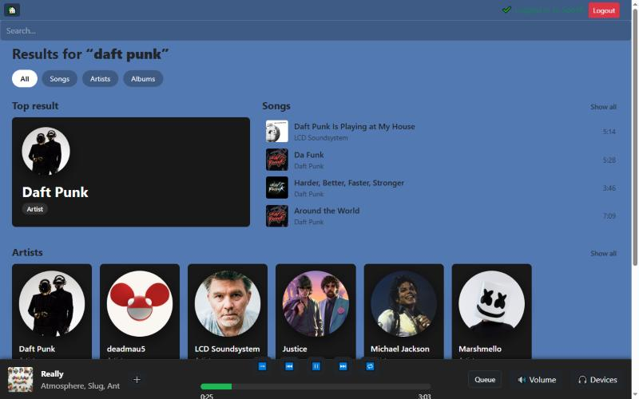
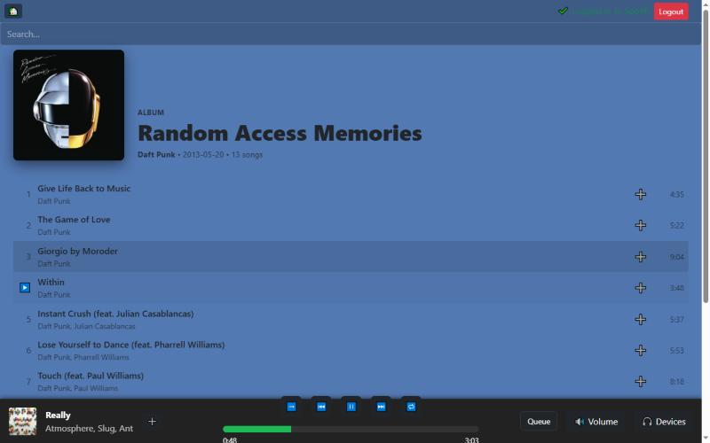
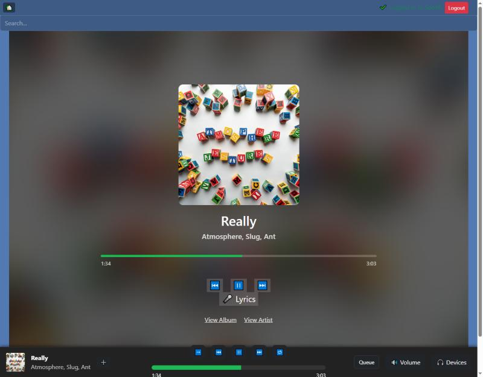
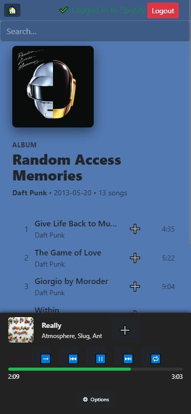
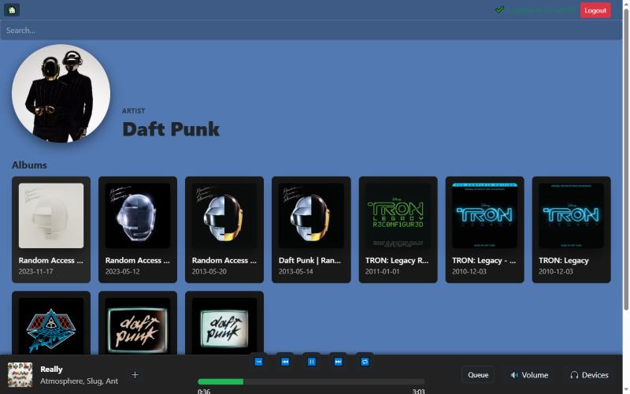
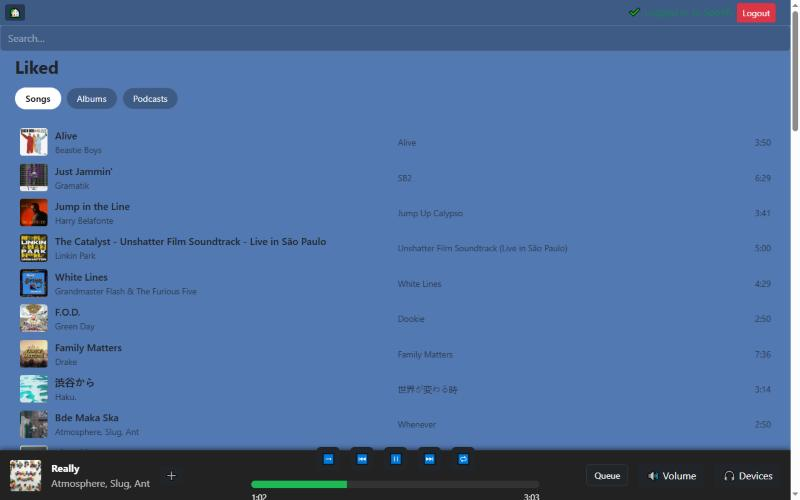
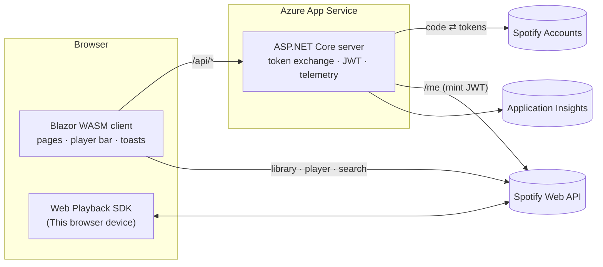
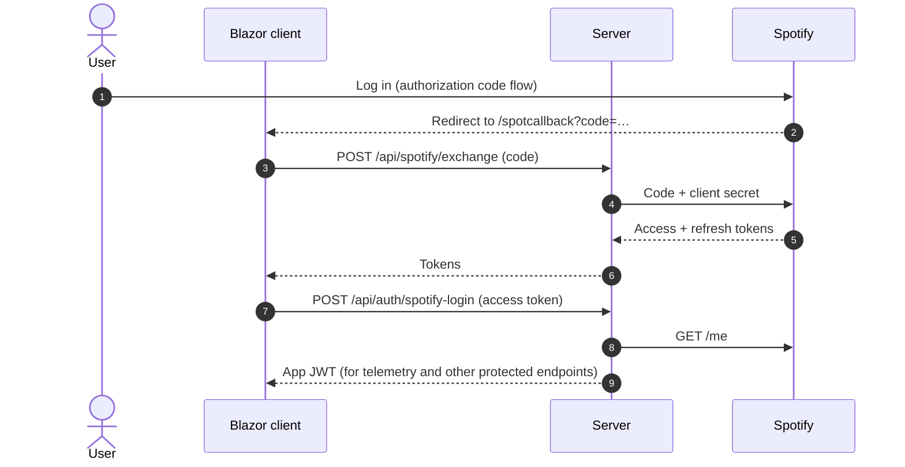

<div align="center">


# SpotifyBlazor

**Your Spotify library, player and podcasts in a fast Blazor WebAssembly app, with playback right in the browser.**

[](https://spotifyblazor-ayb0fch4d9ceaha2.westus3-01.azurewebsites.net/)


[Screenshots](#-screenshots) · [Features](#-features) · [Architecture](#-architecture) · [Getting started](#-getting-started) · [How it works](#-how-it-works) · [Troubleshooting](#-troubleshooting)

</div>

---

## 📸 Screenshots

<p align="center">
  
  <br/><sub><b>Search</b> — top result, songs and artists, with filter chips</sub>
</p>

<table>
<tr>
<td width="37%" align="center" valign="top">
  
  <br/><sub><b>Album</b> — hover a row to play</sub>
</td>
<td width="37%" align="center" valign="top">
  
  <br/><sub><b>Now Playing</b> — controls and lyrics</sub>
</td>
<td width="26%" align="center" valign="top" rowspan="2">
  
  <br/><sub><b>Mobile</b></sub>
</td>
</tr>
<tr>
<td align="center" valign="top">
  
  <br/><sub><b>Artist</b> — albums grid</sub>
</td>
<td align="center" valign="top">
  
  <br/><sub><b>Liked</b> — songs, albums and podcasts</sub>
</td>
</tr>
</table>

---

## ✨ Features

<table>
<tr>
<td width="50%" valign="top">

### 🎧 Listen
- **Play in the browser** — the tab becomes a Spotify Connect device (*🌐 This browser*)
- Now Playing with controls, seek, volume and queue
- Device picker to hand playback between phone, desktop, speakers and browser
- Synced lyrics on the Now Playing screen

</td>
<td width="50%" valign="top">

### 📚 Browse
- Liked Songs, saved Albums and Podcasts
- Album, Artist, Playlist and Podcast pages
- Search across tracks, artists and albums, with filter chips
- Recently Played history

</td>
</tr>
<tr>
<td width="50%" valign="top">

### 🛡️ Reliable
- OAuth login with automatic, single-flight token refresh
- **Error toasts** for failed calls, with a live countdown when rate limited
- Careful polling that stays inside Spotify's rate limits

</td>
<td width="50%" valign="top">

### 📱 Polished
- Consistent UI built from shared page components
- Mobile-friendly layout with a compact player bar
- Application Insights telemetry from client and server

</td>
</tr>
</table>

---

## 🏗️ Architecture

A hosted Blazor WebAssembly app: the ASP.NET Core server serves the client and keeps the Spotify client secret, while the browser talks to Spotify directly for everything else.



| Tech | Used for |
| --- | --- |
| **Blazor WebAssembly** (.NET 8) | The whole UI, hosted by the server |
| **ASP.NET Core** | Token exchange/refresh, JWT minting, telemetry, rate limiting |
| **Spotify Web API** | Library, search, player control |
| **Spotify Web Playback SDK** | Playing audio in the browser tab |
| **Application Insights + Serilog** | Telemetry and logs |

<details>
<summary><b>📁 Project structure</b></summary>

```
SpotifyBlazor/
├── Client/                  # Blazor WASM UI
│   ├── Pages/               # Routed pages (Liked, Album, Artist, Search, ...)
│   ├── Shared/              # PlayerBar, DevicePicker, VolumePopup, Toasts, ...
│   ├── Services/            # SpotifyAuthService, WebPlayerService, TelemetryService,
│   │                        # NotificationService, ErrorNotificationHandler
│   └── wwwroot/             # css/app.css, JS interop (webplayer.js, playerbar.js, ...)
├── Server/                  # API: token exchange/refresh, JWT, telemetry
└── Shared/                  # Models
```

</details>

---

## 🚀 Getting started

### 1. Create a Spotify app

1. Open the [Spotify Developer Dashboard](https://developer.spotify.com/dashboard) and create an app.
2. Add the redirect URI `https://127.0.0.1:7151/spotcallback`.

> [!IMPORTANT]
> Spotify no longer accepts `localhost` redirect URIs. Use the loopback IP `127.0.0.1`.

> [!NOTE]
> Since 2026, **Development Mode** apps need the app owner to have an active **Spotify Premium** subscription and are limited to **5 authorized users** (add them under *User Management*). See Spotify's [February 2026 migration guide](https://developer.spotify.com/documentation/web-api/tutorials/february-2026-migration-guide) for removed endpoints and fields.

### 2. Configure the server

Put these in `Server/appsettings.Development.json` or, better, `dotnet user-secrets`:

| Key | Purpose |
| --- | --- |
| `ConnectionStrings:clientId` | Spotify app client ID |
| `ConnectionStrings:clientSecret` | Spotify app client secret (server only) |
| `ConnectionStrings:callbackUri` | Redirect URI — must exactly match the one in the dashboard |
| `Jwt:Key` / `Jwt:Issuer` / `Jwt:Audience` | App JWT signing and validation |
| `ApplicationInsights:ConnectionString` | Telemetry destination |

> [!WARNING]
> Keep secrets out of source control: use `dotnet user-secrets` locally and App Service application settings in Azure.

### 3. Run it

The server project also serves the WebAssembly client:

```bash
dotnet run --project SpotifyBlazor/Server
```

Then open **https://127.0.0.1:7151** and log in with Spotify.

### ☁️ Deploying

The app is published from Visual Studio to **Azure App Service**. Set the App Service stack to **.NET 8 (LTS)** under *Configuration → General settings* — a framework-dependent .NET 8 build won't start on an older runtime.

### 🏗️ Infrastructure as code (Terraform)

[`infra/`](infra/README.md) builds the Azure side with **Terraform** (`azurerm`): resource group, Linux App Service plan + Web App with a managed identity, **Key Vault** for the Spotify client secret and JWT key (as Key Vault references, so secret values never land in code or Terraform state), and Application Insights on Log Analytics. Dev runs locally; **prod** is built from a reusable module, and state is stored remotely in Azure Storage. A GitHub Actions workflow runs `fmt`, `validate`, a mocked `terraform test`, and a read-only `plan` of prod over OIDC.

```powershell
cd infra/envs/prod
terraform init -backend-config="storage_account_name=<state account>"
terraform plan -out tfplan
```

See [infra/README.md](infra/README.md) for bootstrap, secrets, CI setup and how each Terraform concept maps to the code.

---

## 🔍 How it works

<details>
<summary><b>🔐 Authentication</b></summary>

<br/>



- The client secret never leaves the server.
- Tokens are kept in `localStorage`. Shortly before the access token expires, the client calls `POST /api/spotify/refresh` and mints a fresh JWT.
- Only one refresh runs at a time — concurrent API calls wait for it and reuse the new token, which keeps them under the token endpoint's rate limits.
- Tokens and authorization codes are never written to logs or telemetry.

</details>

<details>
<summary><b>🌐 In-browser playback (Web Playback SDK)</b></summary>

<br/>

After login the app loads the [Spotify Web Playback SDK](https://developer.spotify.com/documentation/web-playback-sdk), turning the tab into a Spotify Connect device named **SpotifyBlazor Web Player** (shown as **🌐 This browser** in the Devices menu).

**Requirements**

- Spotify **Premium** (free accounts get an `account_error`; the Devices menu shows a message)
- The `streaming` scope — already requested at login. If you logged in before it was added, log out and back in.
- HTTPS (or localhost) and a browser with DRM (EME) support — Chrome, Edge and Firefox work

**How it works**

- `wwwroot/webplayer.js` loads the SDK on demand and creates the player. Whenever the SDK needs a token it calls back into .NET (`WebPlayerService.GetAccessToken`), which refreshes first if needed.
- `WebPlayerService` starts the player on login, stops it on logout, and tracks the device ID and errors. Play/pause/track changes in the tab refresh the player bar.
- If you press play and Spotify reports **no active device**, the call is retried on the browser player — with nothing else playing, music just starts in the browser. If another device is active, playback goes there; switch from **🎧 Devices**.
- Browsers block audio until a user gesture, so audio is unlocked on your first click anywhere in the app.

</details>

<details>
<summary><b>⏱️ Spotify rate limits</b></summary>

<br/>

Spotify rate-limits **per app (Client ID)**, shared by every user and every environment — the live site and local runs all count against the same allowance. When it runs out, Spotify answers `429 Too Many Requests` (`QUOTA_EXCEEDED`), and login is usually the first thing to break.

The app keeps its background traffic small:

| What | How often |
| --- | --- |
| Player bar "now playing" | Every 10 s |
| Now Playing page | Every 10 s, only while the page is open |
| Device list | Every 5 s, only while the 🎧 Devices menu is open |
| Queue | Only while the queue panel is open |
| Playback changes (play/skip, browser player events) | Bursts collapse into one refresh, at most every 2 s |

💡 **Tip:** if you add polling, give it a `CancellationToken` and stop it in `Dispose` — otherwise it keeps running after you navigate away.

**Wait times:** Spotify's CORS headers don't expose `Retry-After` to browsers, so the client can't see how long to wait on direct Spotify calls. Calls that go through the server (`/api/spotify/exchange`, `/api/spotify/refresh`, `/api/auth/spotify-login`) pass Spotify's `429` and `Retry-After` through, and the server's own rate limiter also answers `429` with `Retry-After`. Those show a countdown in the error toast.

</details>

<details>
<summary><b>🔔 Error notifications</b></summary>

<br/>

`ErrorNotificationHandler` sits on the client's `HttpClient`, so every failed call raises a toast without per-call code:

- The toast shows the source (Spotify or Server), status, endpoint and the error message from the response body (Spotify's `error.message` or the server's problem `detail`).
- 🟥 5xx and 429 are red; 🟧 other 4xx are orange. Network failures get a toast too.
- Repeats of the same error collapse into one toast with a ×N count. Toasts close after 8 s; rate-limit toasts stay until the wait is over (max 5 min).
- `/api/telemetry` failures are ignored (they're expected before login).

Show your own message with `NotificationService.ShowError(...)` / `ShowWarning(...)`.

</details>

<details>
<summary><b>🗂️ Static file caching</b></summary>

<br/>

The server sends `Cache-Control: no-cache` for the app's own `.css`, `.js` and `.html` (including `index.html`), so browsers revalidate on every load — a cheap `304` when nothing changed — and pick up a new publish immediately. Blazor's `_framework` files manage their own caching.

`index.html` links the stylesheets with `?v=2`. That was a one-time bump to push phones off an old cached copy; with `no-cache` in place it doesn't need changing on each publish.

</details>

---

## 🩺 Troubleshooting

| Symptom | What to do |
| --- | --- |
| **"No music playing" when pressing play** | No Spotify device is active and the web player isn't ready. Open **🎧 Devices** and look for **This browser** or an error message. |
| **Web player error in the Devices menu** | "Needs Spotify Premium" means a free account. An authentication error usually means your login predates the `streaming` scope — log out and back in. |
| **Plays but no sound** | Click anywhere on the page once; browsers block audio until you interact. |
| **Everything stops after about an hour** | Token refresh is failing. Check the server logs for `/api/spotify/refresh` errors (e.g. rate limiting or a changed client secret). |
| **Login fails with "Spotify rate limit" / `429 QUOTA_EXCEEDED`** | The app's Client ID is out of Spotify API allowance. Close every open tab of the app (live and local share the quota), wait for the countdown or a few minutes, then log in again. See [Spotify rate limits](#-how-it-works). |
| **Login fails with a 5xx from `/api/auth/spotify-login`** | The toast and the browser console show what Spotify's `/me` returned (e.g. 401 expired token, 403 user not on the app's allowlist). |
| **Phone still shows the old layout after a publish** | The browser cached the old CSS. Reload once; if it persists, open the site in an Incognito tab or clear the site's cached files. |

---

<div align="center">

Built with 💚 and Blazor · Not affiliated with or endorsed by Spotify

</div>
