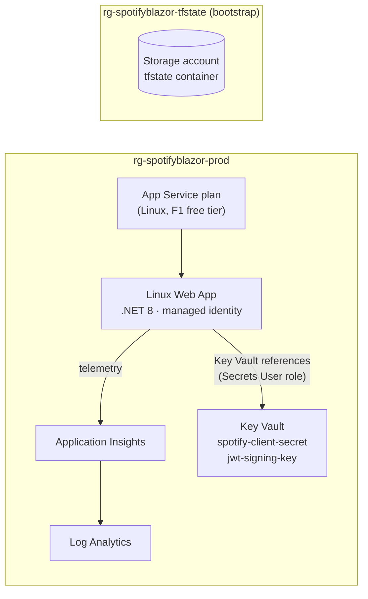

# Infrastructure (Terraform)

This folder describes SpotifyBlazor's Azure infrastructure as code, using Terraform and the `azurerm` provider. `terraform apply` builds the production environment from nothing, and CI checks every change and shows the plan before anything is applied.

There's no hosted dev environment: dev is your machine (`dotnet run` with `dotnet user-secrets`), and prod is Azure.

## What it builds



**Why App Service and not a Static Web App?** This is a *hosted* Blazor WebAssembly app. The ASP.NET Core server exchanges Spotify codes for tokens with the client secret and signs JWTs, so it needs a real server process. A Static Web App would only fit a client-only WASM app.

## Layout

```
infra/
├── bootstrap/            # Run once: storage account for remote state (local state)
├── modules/spotify-app/  # Reusable module: everything one environment needs
│   └── tests/            # `terraform test` with mocked providers
└── envs/
    └── prod/             # Root module: backend + provider + module call, F1 (free)
```

## Concepts, mapped to this code

| Concept | What it is | Where |
| --- | --- | --- |
| **Provider** | Plugin that turns HCL into API calls (`azurerm` → Azure Resource Manager). Pinned with `~> 5.0`, so it takes 5.x updates but never 6.0. Exact versions and hashes are in `.terraform.lock.hcl`, which is committed. | `required_providers` in every root |
| **Resource** | Something Terraform creates and owns, e.g. `azurerm_linux_web_app`. | `modules/spotify-app/main.tf` |
| **Data source** | Something Terraform only reads, e.g. `azurerm_client_config` (who's logged in). | `data "azurerm_client_config"` |
| **State** | Terraform's record of which real resource matches which block. `plan` compares code with state and with what's actually in Azure. | Azure Storage, one blob per environment |
| **Remote backend** | State kept in a shared, locked, versioned place instead of on your laptop, so CI and you see the same state and two applies can't run at once (blob lease lock). | `backend "azurerm"` in `envs/*/main.tf` |
| **Module** | A reusable folder of `.tf` files with inputs (variables) and outputs. prod calls it today; a hosted test environment would be one more small folder calling the same module with different inputs. | `modules/spotify-app` |
| **Variables** | Typed inputs, with defaults and `validation`. Values come from `terraform.tfvars` (non-secret, committed), `TF_VAR_*` environment variables, or `-var`. | `variables.tf`, `terraform.tfvars` |
| **Locals** | Computed names and values, so they're written once. | `locals {}` in the module |
| **Outputs** | Values a module or root returns, e.g. the web app name to deploy to. | `outputs.tf` |
| **Implicit dependencies** | Referencing `azurerm_key_vault.this.name` tells Terraform to create the vault first. No `depends_on` needed. | App settings → Key Vault |
| **Lifecycle** | `prevent_destroy` guards the state account; `ignore_changes` keeps deployments from being "fixed" back by the next apply. | bootstrap, web app |
| **plan / apply** | `plan` is a dry run that shows the diff. `apply` makes the changes. Saving the plan (`-out`) means apply does exactly what you reviewed. | See below |

## Secrets: what's where

- **Never in git:** no secrets in `.tf` or `.tfvars`. State files, plans and `.terraform/` are git-ignored.
- **Never in Terraform state:** Terraform creates the Key Vault and grants the web app's managed identity read access. The secret *values* are put into the vault with `az keyvault secret set`. Any value Terraform sets ends up in plain text in state, so Terraform never sets them.
- **At runtime:** app settings such as `ConnectionStrings__clientSecret` hold a Key Vault reference, `@Microsoft.KeyVault(VaultName=…;SecretName=spotify-client-secret)`. App Service resolves it with the app's identity.
- **State itself is protected:** the state storage account has public access and shared keys disabled, so only Entra ID identities with a blob data role can read it. Blob versioning keeps every previous state.
- **CI has no stored Azure secret:** GitHub Actions logs in with OIDC (workload identity federation). Entra ID trusts tokens from this repository's workflows, so no client secret exists to leak or rotate.

## Running it (Windows / PowerShell)

Prerequisites: `winget install Hashicorp.Terraform Microsoft.AzureCLI`, then:

```powershell
az login
$env:ARM_SUBSCRIPTION_ID = az account show --query id -o tsv   # azurerm 5.x requires it
```

### 1. Bootstrap remote state (once per subscription)

```powershell
cd infra/bootstrap
terraform init                    # downloads providers into .terraform/
terraform plan -out tfplan        # review: 1 RG, 1 storage account, 1 container, 1 role
terraform apply tfplan
terraform output storage_account_name   # e.g. stsbtfstateab12cd; save this
```

Bootstrap keeps its own (small, git-ignored) local `terraform.tfstate`. Back it up, or move it into the new account later with `terraform init -migrate-state`.

### 2. Plan and apply prod

```powershell
cd ../envs/prod
$env:TF_VAR_spotify_client_id = "<Spotify app client ID>"
terraform init -backend-config="storage_account_name=<from step 1>"
terraform fmt -check -recursive ../..   # style
terraform validate                       # syntax, types, references
terraform plan -out tfplan               # the diff; read it
terraform apply tfplan
```

If `init` returns a 403 right after bootstrap, the new blob role is still propagating. Wait a minute and run it again.

### 3. Put the secrets in Key Vault (once)

```powershell
$kv = terraform output -raw key_vault_name
az keyvault secret set --vault-name $kv --name spotify-client-secret --value "<Spotify client secret>"

$bytes = New-Object byte[] 48
[Security.Cryptography.RandomNumberGenerator]::Create().GetBytes($bytes)
az keyvault secret set --vault-name $kv --name jwt-signing-key --value ([Convert]::ToBase64String($bytes)) --output none

az webapp restart -g (terraform output -raw resource_group_name) -n (terraform output -raw web_app_name)
```

Then add `terraform output -raw callback_uri` to the Spotify app's Redirect URIs, and deploy the code from the repo root:

```powershell
dotnet publish SpotifyBlazor/Server -c Release -o publish
Compress-Archive publish/* app.zip -Force
az webapp deploy -g <resource group> -n <web app name> --src-path app.zip --type zip
```

### Tests

```powershell
cd infra/modules/spotify-app
terraform init -backend=false
terraform test        # plans against mocked providers: no Azure login, no cost
```

### Tearing down

`terraform destroy` in `envs/prod` removes the environment. The prod Key Vault has purge protection, so it stays soft-deleted (recoverable) for 7 days and its name can't be reused until then.

## CI (GitHub Actions)

[`.github/workflows/terraform.yml`](../.github/workflows/terraform.yml) runs on every PR and push to `main` that touches `infra/`:

1. **fmt + validate + test**: `terraform fmt -check`, `validate` for bootstrap and prod, and the mocked `terraform test`. It needs no Azure access, so it always runs.
2. **plan (prod)**: a read-only `terraform plan` against real Azure, with the result in the job summary. It is skipped until the repository variables below exist. CI never runs `apply`.

To turn on the plan job, create an identity for GitHub and trust this repo through OIDC:

```powershell
$app = az ad app create --display-name "github-spotifyblazor-terraform" | ConvertFrom-Json
az ad sp create --id $app.appId
$sub = az account show --query id -o tsv

# Plan reads everything; Website Contributor is needed to read web app settings.
az role assignment create --assignee $app.appId --role Reader --scope /subscriptions/$sub
az role assignment create --assignee $app.appId --role "Website Contributor" --scope /subscriptions/$sub
az role assignment create --assignee $app.appId --role "Storage Blob Data Reader" `
  --scope (az storage account show -n <state account> --query id -o tsv)

foreach ($c in @(@{n="pull-requests"; s="pull_request"}, @{n="main"; s="ref:refs/heads/main"})) {
  @{ name = $c.n; issuer = "https://token.actions.githubusercontent.com"
     subject = "repo:RobWiersma/SpotifyBlazor:$($c.s)"; audiences = @("api://AzureADTokenExchange") } |
    ConvertTo-Json | Set-Content fic.json
  az ad app federated-credential create --id $app.appId --parameters fic.json
}
Remove-Item fic.json
```

Then, under GitHub → Settings → Secrets and variables → Actions → **Variables**, add `AZURE_CLIENT_ID` (`$app.appId`), `AZURE_TENANT_ID`, `AZURE_SUBSCRIPTION_ID`, `TFSTATE_STORAGE_ACCOUNT` and `SPOTIFY_CLIENT_ID`. These are identifiers, not secrets: the trust is the federated credential, so knowing the IDs doesn't let anyone log in.

To let CI apply later, give a separate identity Contributor plus Role Based Access Control Administrator, and run it only from `main` behind a GitHub Environment with required reviewers.

## Adopting the existing live site

The current live site (`ResourceGroup1`, published from Visual Studio) was created by hand and isn't managed by this code. These environments are new and separate. To bring a hand-made resource under Terraform, write the matching block and add an `import` block. `plan` then shows "1 to import" instead of "1 to add":

```hcl
import {
  to = module.app.azurerm_linux_web_app.this
  id = "/subscriptions/<sub>/resourceGroups/ResourceGroup1/providers/Microsoft.Web/sites/SpotifyBlazor"
}
```

(The existing site is published with Web Deploy, which points to a Windows App Service, so it would need an `azurerm_windows_web_app` block rather than the Linux one.)

## Talking points

- **Why remote state?** One shared, locked, versioned source of truth for laptops and CI. Local state can't be shared, has no lock, and gets lost.
- **Why a module with only one environment?** Dev is local, so prod is the only hosted environment today. Keeping the resources in a module means a hosted test or staging environment is a ten-line folder with its own state file, built exactly like prod, and the module can be tested on its own with `terraform test`.
- **Why is the secret not in Terraform?** State stores every attribute in plain text. Terraform owns the vault and who can read it; the value goes in out-of-band, and the app reads it with a managed identity. (Newer providers also offer write-only `value_wo` attributes that are never stored in state.)
- **How is CI safe?** Format, validate and test run with no credentials. Plan uses OIDC with read-only roles and no stored secret. Apply would be a separate, approved step.
- **What does the lock file do?** It pins exact provider versions and checksums for every OS, so a laptop and a CI runner install the same provider.
